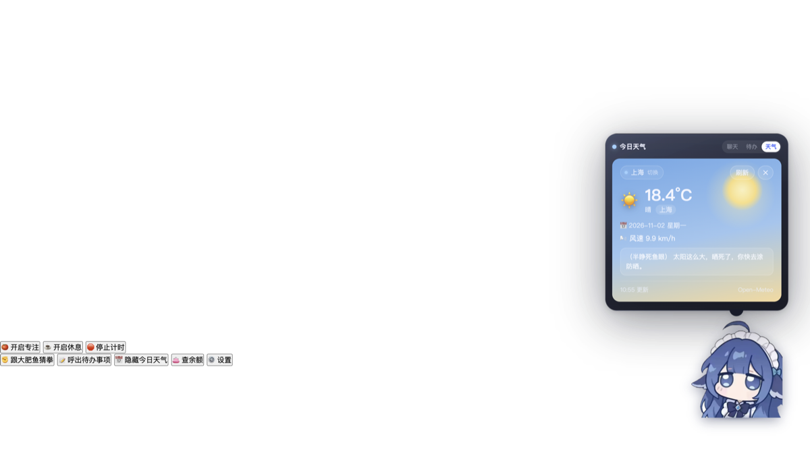
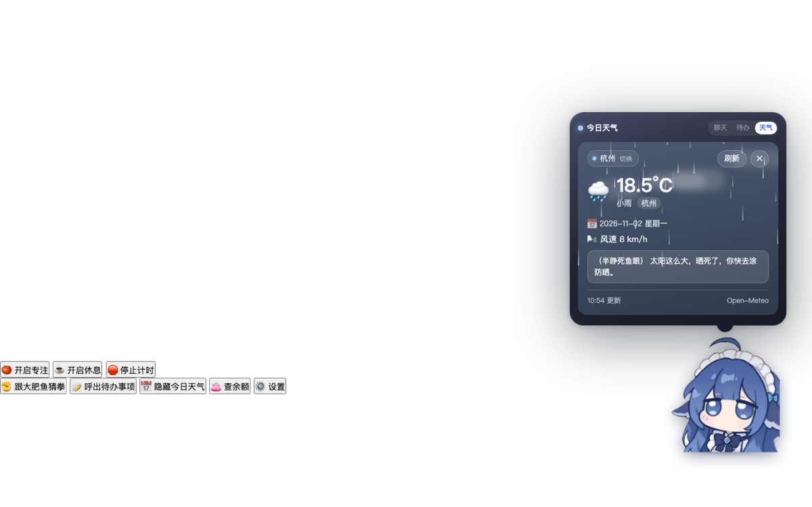
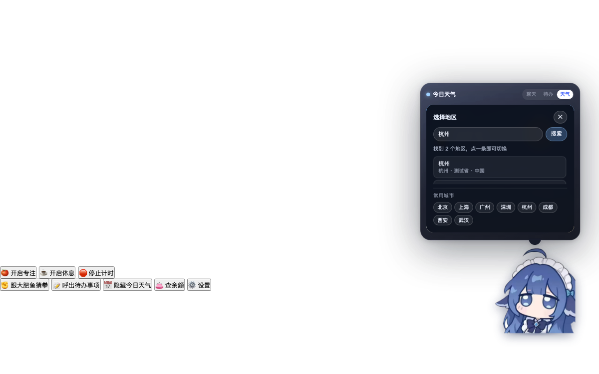

<div align="center">


# Prompt Pet · 代码精灵

**一个常驻桌面、完全不挡你干活的透明桌宠。**
会聊天、会吐槽、会陪你专注计时，还能顺手看看今天天气。


</div>

---

## 这是什么

写代码时想问 AI 一句话，却要先切窗口、开网页、登录——心流断一次，状态回不来。

Prompt Pet 把这件事压缩成**点一下桌上那个小东西**。

它以一个透明悬浮球的形式待在屏幕角落：

- 点击旁边 = 点的就是桌面图标，**完全穿透**，不挡任何操作
- 永远置顶，不会被其他窗口盖住
- 不占 Dock，不占任务栏
- 只是安静待着，需要时戳一下

技术上是 Electron 全屏透明窗口 + 原生 HTML/CSS/JS，**没有任何构建步骤**——改完代码 `npm start` 就是最新版本。

<!-- 截图：聊天 -->
<div align="center">
  
</div>

---

## 特性

### 桌面交互

| 能力 | 说明 |
| --- | --- |
| 鼠标穿透 | 靠 `setIgnoreMouseEvents(true, { forward: true })` 实现；球体附近才接管鼠标 |
| 拖拽 + 惯性 | 甩出去会滑行、减速，撞到边缘有 Q 弹反馈 |
| 点击 Q 弹 | 单击时角色会「压扁 → 拉长 → 回弹」，独立的缩放层承载，不干扰定位与呼吸动画 |
| 待机呼吸 | 身体轻微起伏、脚下投影呼吸，不是一张死图 |
| 状态机 | 待机 / 睡眠 / 思考 / 变身，四态切换各有专属立绘 |

### AI 对话

| 能力 | 说明 |
| --- | --- |
| 气泡聊天 | 点击弹出气泡，输入的问题直接发给 DeepSeek |
| 三档思考深度 | 低 / 高 / 极致，对应三套不同立绘差分，切换时有变身动画 |
| 本地记忆 | 对话摘要与好感度存在本地，不用每次从零开始 |
| 余额查询 | 右键直接查 API 余额，不用去后台翻页面 |
| 剪贴板吐槽 + 语音 | 检测到代码片段时的碎碎念，可开关语音播报 |

### 生产力工具

| 能力 | 说明 |
| --- | --- |
| 待办清单 | 气泡第二页，本地持久化 |
| 番茄钟 | 专注 / 休息计时，倒计时直接显示在头顶 |
| 今日天气 | 气泡第三页，六类天气各自配套背景动效（晴 / 云 / 雨 / 雪 / 雾 / 雷暴） |
| 地区选择 | 8 个常用城市一键切换，也支持全球任意城市检索 |

### 彩蛋

- 猜拳小游戏，输了会被击飞
- 好感度会随互动变化，说话语气也会跟着变

---

## 截图

<table>
  <tr>
    <td align="center" width="50%">
      <br />
      <sub>右键菜单：番茄钟 / 待办 / 天气 / 余额 / 设置</sub>
    </td>
    <td align="center" width="50%">
      <br />
      <sub>天气页：晴天背景，实时数据</sub>
    </td>
  </tr>
  <tr>
    <td align="center" width="50%">
      <br />
      <sub>雨天：44 层雨滴各自独立下落</sub>
    </td>
    <td align="center" width="50%">
      <br />
      <sub>地区选择：常用城市 + 全球检索</sub>
    </td>
  </tr>
</table>

---

## 快速开始

**环境要求**

- macOS（在 macOS 26 上开发与验证；其他平台理论上可运行但未做深度测试）
- Node.js 22 或更高
- 一个 DeepSeek API Key（[在这里申请](https://platform.deepseek.com/api_keys)）

```bash
git clone <your-repo-url>
cd prompt-pet
npm install
npm start
```

首次启动后：

1. 右键桌宠 → **⚙️ 设置**
2. 填入你的 API Key
3. 回到气泡，随便问一句试试

调试模式（打开 DevTools）：

```bash
npm run dev
```

---

## 关于 API Key

**仓库里不存在任何密钥。** 这一点是刻意的设计：

- API Key 只保存在你本机的 `localStorage`，路径在 `~/Library/Application Support/Prompt Pet/` 下
- 请求由主进程发起，Key 不经过渲染进程的 DOM
- `.gitignore` 已排除 `.env`，项目本身也不需要 `.env`

所以这个仓库可以放心公开——**没有 Key 的人跑起来只会得到一个不会说话的桌宠**。

⚠️ 如果你自己改了代码、想把 Key 写进配置文件，请务必先确认它已被 `.gitignore` 覆盖。

---

## 操作方式

| 操作 | 效果 |
| --- | --- |
| 单击桌宠 | 开关气泡 |
| 按住拖动 | 移动，松手有惯性滑行 |
| 右键 | 打开功能菜单 |
| `⌃⌥P` | 显示 / 隐藏桌宠（全局） |
| `⌃⌥Q` | 退出程序（全局） |

> 快捷键可以在 `src/main.js` 的 `registerGlobalShortcuts()` 里改。

---

## 项目结构

```
prompt-pet/
├── src/
│   ├── main.js          # 主进程：窗口、托盘、快捷键、网络请求、IPC
│   ├── preload.js       # contextBridge 白名单，渲染进程唯一出口
│   ├── renderer.js      # 渲染进程：状态机、气泡、拖拽、天气、番茄钟
│   ├── index.html       # 单页结构 + CSP
│   ├── style.css        # 全部样式：立绘动画、气泡、菜单、天气动效
│   └── assets/          # 立绘差分、图标
├── docs/
│   ├── images/          # README 截图
│   ├── PROJECT_SCOPE.md # DEFINE 阶段：要做什么、不做什么
│   ├── PLAN.md          # 各 Phase 的目标与验收标准
│   ├── DECISIONS.md     # 关键技术取舍与原因
│   ├── DEV_LOG.md       # 逐阶段开发记录
│   └── ERROR_LOG.md     # 踩过的坑与修法
├── package.json
└── LICENSE
```

---

## 技术栈与取舍

**Electron 45 + 原生 HTML/CSS/JS，零构建步骤。**

| 选择 | 原因 |
| --- | --- |
| 不引入 React / Vue | 项目规模小，框架只会增加复杂度和出错面；省掉打包环节，改完直接生效 |
| 全屏透明窗口 + CSS 定位 | 比「小窗口跟随鼠标」简单得多，也给气泡留足空间 |
| `setIgnoreMouseEvents(true, { forward: true })` | 官方穿透方案，且穿透时仍能收到 `mousemove`，才能实现"靠近才接管" |
| 动画分层 | `#pet` 只管 `translate3d` 定位、`.pet-core` 管呼吸与冲击、`#pet-duang` 管点击缩放——三者分开，谁也不覆盖谁 |
| preload + contextBridge | `contextIsolation: true`、`nodeIntegration: false`、`sandbox: true`，渲染进程碰不到 Node |

更完整的决策记录见 [docs/DECISIONS.md](docs/DECISIONS.md)。

---

## 已知限制

- **未签名**：本仓库只提供源码。自行打包出的 `.app` 在本机可正常运行；如果你要分发，需要 Apple 开发者证书签名并公证。
- **托盘图标可能不显示**：macOS 26 上，未用开发者证书签名的进程创建的 `NSStatusItem` 可能只占位不绘制。因此额外提供了 `⌃⌥P` / `⌃⌥Q` 两个全局快捷键作为兜底。
- **天气与地区检索**依赖 [Open-Meteo](https://open-meteo.com/)（免密钥），需要联网。
- **仅 macOS 深度测试**：代码里有平台判断，但 Windows / Linux 未验证。

---

## 文档

这个项目是严格按 Phase 迭代做的，每个阶段都有目标、验收标准和事后复盘：

- [PROJECT_SCOPE.md](docs/PROJECT_SCOPE.md) — 为什么做这个、明确不做什么
- [PLAN.md](docs/PLAN.md) — 每个 Phase 要交付什么
- [DECISIONS.md](docs/DECISIONS.md) — 技术选型的理由
- [DEV_LOG.md](docs/DEV_LOG.md) — 逐阶段开发日志
- [ERROR_LOG.md](docs/ERROR_LOG.md) — 遇到的问题与解决方案

---

## License

[MIT](LICENSE) © 2026 katzegott

立绘素材由本项目使用 AI 图像生成工具产出。
